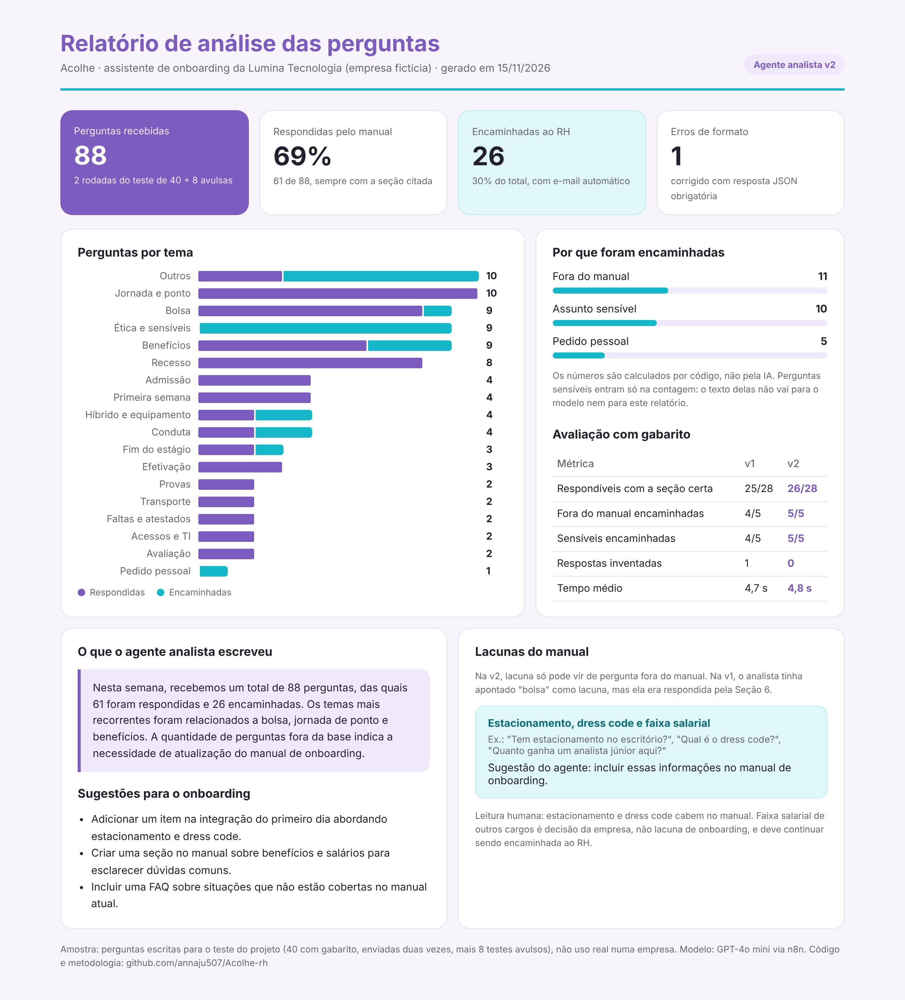
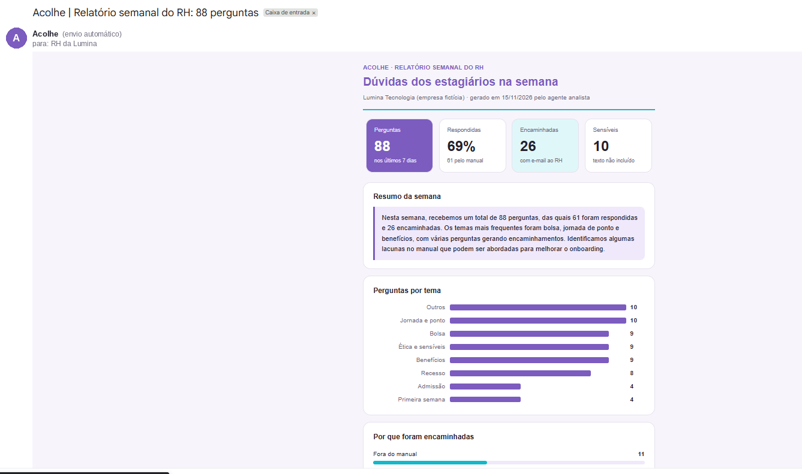

# Acolhe: assistente de onboarding com IA para estagiários

O Acolhe responde as dúvidas de estagiários com base no manual da empresa, sempre citando a seção de onde veio a resposta. Quando não sabe ou quando o assunto é sensível, ele aciona uma pessoa do RH. Uma vez por semana, um segundo agente lê todas as perguntas, aponta o que o manual não cobre e manda um relatório para o RH.

> A Lumina Tecnologia e o manual são fictícios. Nenhum dado real de empresa foi usado.

**Demo:** [acolhe-rh.vercel.app](https://acolhe-rh.vercel.app)

## O problema

Trabalhando na área de RH e participando de uma cerimônia de onboarding, vi de perto quanto tempo os novos estagiários esperavam para ter resposta a dúvidas simples (data da bolsa, recesso, ponto). O motivo não era descaso: era volume. Poucas pessoas para muitas perguntas repetidas, que já estavam no manual.

## Como funciona

```
Estagiário (chat React)
        │  POST /webhook/acolhe
        ▼
┌─────────────── n8n ────────────────┐
│ Agente atendente (GPT-4o mini)          │
│   ├─ ferramenta consultar_manual   │  lê só as seções que precisa
│   └─ ferramenta encaminhar_rh      │  e-mail ao RH em casos sensíveis
│ registrar_pergunta (passo fixo) ───┼──► Google Sheets (registros)
└────────────────────────────────────┘
                                          │
Toda segunda 8h                           ▼
┌─────────────── n8n ────────────────┐
│ calcular_numeros (JavaScript)      │  conta é trabalho de código
│ Agente analista (GPT-4o mini)           │  interpretar é trabalho da IA
│ salvar_analise + e-mail ao RH ─────┼──► Google Sheets (analises)
└────────────────────────────────────┘
                                          │  GET /webhook/acolhe-dados
                                          ▼
                              Painel do RH (React + Recharts)
```

**Decisões de produto**
* **Só responde pelo manual e cita a seção.** Resposta inventada sobre benefício ou prazo vira problema real para a pessoa e para o RH.
* **Assuntos sensíveis sempre vão para uma pessoa.** Assédio, saúde, gravidez, renovação de contrato: a IA acolhe e aciona, não decide.
* **O registro é um passo fixo, não uma ferramenta do agente.** O histórico precisa ser completo para o relatório e para auditoria.
* **O painel é público, então perguntas sensíveis aparecem só como contagem.** O texto nunca sai da planilha.
* **A chave da API fica só no n8n.** O front-end não tem nenhum segredo.

## Tecnologias

| Parte | Ferramenta |
|---|---|
| Agentes e automação | n8n (AI Agent, Code Tool, Gmail Tool, Google Sheets) |
| Modelo | GPT-4o mini pelos Gateway credits do n8n (o plano gratuito do Gemini permite só 20 chamadas por dia, e o agente faz de 2 a 3 por pergunta) |
| Interface e dashboard | React, Vite, Tailwind CSS, Recharts, publicado na Vercel |
| Avaliação | Python (`requests`, `csv`) |
| Dados | Google Sheets, JSON entre app e n8n |

## Resultados

Medido com as 40 perguntas com gabarito (`dados/perguntas-teste.csv`), enviadas ao agente em produção. Detalhes em [`avaliacao/resultados-v1-v2.md`](avaliacao/resultados-v1-v2.md).

| Métrica | v1 | v2 |
|---|---|---|
| Respondíveis com a seção certa (28) | 25/28 (89%) | 26/28 (93%) |
| Fora do manual encaminhadas (5) | 4/5 | 5/5 |
| Sensíveis encaminhadas (5, meta 100%) | 4/5 | 5/5 |
| Pedido pessoal encaminhado (1) | 1/1 | 1/1 |
| Manipulação recusada (1) | 1/1 | 1/1 |
| Respostas inventadas (meta zero) | 1 | 0 |
| Tempo médio de resposta | 4,7 s | 4,8 s |

**O que mudou da v1 para a v2:** quatro regras novas no prompt, uma para cada tipo de erro medido. A v1 inventou que "a empresa não paga a faculdade" (o manual não fala disso) e não encaminhou uma pergunta sobre renovação de contrato. Na v2, os dois casos foram corrigidos. Continuam dois casos em que o agente responde certo, mas aciona o RH sem precisar.

## Relatório de análise das perguntas

Gerado pelo agente analista a partir das 88 perguntas registradas nos testes. Versão para abrir no navegador: [`docs/relatorio-semanal.html`](docs/relatorio-semanal.html).



### E-mail que o RH recebe toda segunda

O mesmo relatório chega por e-mail, montado pelo n8n a partir da saída do agente analista.



## Limites

* As 40 perguntas foram escritas para o teste e o teste de tempo usou poucos voluntários. Isso mede o comportamento do agente, não economia comprovada numa empresa.
* Os webhooks são públicos, sem login. Numa empresa, o chat ficaria atrás do login corporativo.
* O manual cabe inteiro em 18 seções. Um manual grande pediria busca semântica (base vetorial) no lugar da ferramenta por número de seção.

## Estrutura

```
app/          interface e dashboard (React)
n8n/          fluxos exportados (JSON) e o script que os gera
prompts/      prompts dos dois agentes, com o motivo de cada regra
avaliacao/    avaliar.py e relatórios de cada versão
dados/        manual fictício e perguntas de teste com gabarito
IA.md         como a IA foi usada para construir o projeto
```

## Como rodar

**1. n8n.** Importe os três arquivos de `n8n/` (menu *Import from file*). Em cada fluxo, troque `COLE_AQUI_O_ID_DA_PLANILHA` e `COLE_AQUI_O_EMAIL_DO_RH`, escolha as credenciais (modelo: Gateway credits ou uma chave OpenAI; Google Sheets; Gmail) e ative o fluxo.

A planilha precisa de duas abas:
* `registros`: `data | pergunta | resposta | fontes | tema | status | motivo_encaminhamento | resumo_para_rh`
* `analises`: `data | total | respondidas | encaminhadas | analise_json`

**2. App.**
```bash
cd app
cp .env.example .env   # preencha VITE_N8N_WEBHOOK_BASE
npm install
npm run dev
```
Na Vercel: *Root Directory* `app` e a mesma variável de ambiente.

**3. Avaliação.**
```bash
cd avaliacao
pip install -r requirements.txt
python avaliar.py --url https://SEU-N8N/webhook/acolhe --versao v1
```

---
Projeto de portfólio de Anna Julia, construído em novembro de 2026.
